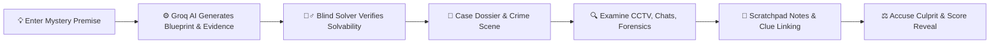

# 🕵️‍♂️ AI Mystery Room
### *Deductive Investigation Bureau — Procedural AI Murder Mysteries*

[](https://nodejs.org/)
[](https://react.dev/)
[](https://vitejs.dev/)
[](https://tailwindcss.com/)
[](https://groq.com/)
[](https://www.mongodb.com/)
[](https://vitest.dev/)
[](LICENSE)

An immersive, full-stack procedural mystery game where every case is generated from any premise in seconds using **Groq's ultra-fast LPU inference**, verified by an AI **Blind Detective** for guaranteed solvability, and cracked by the player through interactive crime scene evidence, CCTV surveillance feeds, and a detective scratchpad.

---

## 🌟 Key Features

### 🧠 Solution-First Generative Pipeline
- **Internally Consistent Plots:** Rather than improvising on the fly, the generation engine invents the true culprit, motive, opportunity, method, and a strict 24-hour timeline *first*.
- **Subtle Clue Distribution:** Spreads decisive links, supporting clues, and convincing red herrings across suspects and evidence items.
- **Lightning-Fast Generation:** Powered by **Groq** (`openai/gpt-oss-120b`), generating deep, multi-layered mysteries in seconds.

### ⚖️ Fair Solvability & Blind Verification
- **Automated Blind Solver:** Before any case is saved as playable, an independent AI solver analyzes *only* the discovered evidence without knowing the answer beforehand.
- **Strict Quality Threshold:** If the solver cannot deduce the true culprit with $\ge 60\%$ confidence or discovers an unresolvable contradiction, the system repairs or regenerates the case automatically.

### 🛡️ Zero-Spoiler Guarantee
- **Server-Side Allowlist Serialization:** Culprit IDs, true solution timelines, and key evidence identifiers are marked with `{ select: false }` in Mongoose and completely stripped before reaching the client.
- **Zero Client-Side Leaks:** Even by opening Chrome DevTools or inspecting network packets, players cannot cheat until the formal verdict is submitted.

### 🔎 Realistic Multimedia Evidence Viewers
- **📹 CCTV Surveillance Feed:** Retro CRT scanline monitor, `REC` indicator, live timestamps, and scrubbable timeline slider.
- **💬 Intercepted Chats:** Messaging dialogue with sender timestamps, delivery ticks, and deleted message markers.
- **📄 Official Documents:** Styled coroner reports, unsigned wills, letters, and receipts with authenticated case stamps.
- **🗣️ Witness & Suspect Statements:** Transcripts of official interrogations with claimed alibis.
- **🔬 Forensics & Access Logs:** Laboratory chemical analysis, brass filings, keycard badge logs, and timestamps.

### 📓 Interactive Detective Tools
- **Auto-Saving Scratchpad / Notebook:** Record deductions, notes, and timeline inconsistencies in real-time with automatic cloud persistence.
- **Suspect Lineup & Profiles:** Quick-reference cards detailing ages, occupations, claimed alibis, and initial statements.
- **Evidence Pinboard:** Visual board linking suspects to physical clues.
- **Contextual AI Mentor Hints:** Requests guidance without ever spoiling the culprit's name or identity.
- **Formal Accusation & Scoring Engine:** Submit your final theory and receive a detective rating based on attempts, hints used, and deductive accuracy.

---

## 🎮 Gameplay Flow



1. **Case Dossier:** Read the incident briefing, victim summary, setting, and the 4 suspects of interest.
2. **Investigation:** Open evidence cards on the left panel to examine CCTV sightings, broken alibis, and forensic reports.
3. **Scratchpad:** Click the **Notebook** tab to write down timeline discrepancies (e.g. cross-referencing military time `22:15` against a suspect's claimed alibi).
4. **Indictment:** When confident, click **Accuse Culprit**, choose the suspect, type your deduction theory, and discover if you cracked the case!

---

## 🛠️ Tech Stack

| Layer | Technologies |
| :--- | :--- |
| **Frontend** | React 18, Vite 6, Tailwind CSS 3.4, TanStack Query, Zustand, Lucide React Icons |
| **Backend** | Node.js 20 LTS (ES Modules), Express 4, Mongoose 8, Zod schema validation |
| **AI Inference** | **Groq SDK** (`openai/gpt-oss-120b`, `llama-3.3-70b-versatile`), JSON Mode, Structured Schemas |
| **Database** | MongoDB (with automatic fallback to `mongodb-memory-server` for zero-setup local dev) |
| **Testing** | Vitest 3, Supertest (14 automated milestone tests) |
| **Security** | Helmet, CORS, Express Rate Limit, Express Mongo Sanitize, httpOnly Cookie sessions |

---

## 🚀 Quickstart & Installation

### Prerequisites
- [Node.js](https://nodejs.org/) (v20+ recommended)
- A free **Groq API Key** from [Groq Console](https://console.groq.com/keys)

### 1. Clone the Repository
```bash
git clone https://github.com/Arvindkumar-star/AI_MYSTERY_ROOM.git
cd AI_MYSTERY_ROOM
```

### 2. Install Dependencies
```bash
# Installs root, client, and server dependencies in one command
npm install
```

### 3. Configure Environment Variables
Copy the `.env.example` file to create your server `.env`:

```bash
cp server/.env.example server/.env
cp client/.env.example client/.env
```

Edit `server/.env` with your preferred settings and API key:
```env
PORT=5000
NODE_ENV=development
CLIENT_ORIGIN=http://localhost:5173
COOKIE_SECRET=detective-mystery-secret-32-chars-key

# Groq AI Configuration
GROQ_API_KEY=your_groq_api_key_here
GROQ_TEXT_MODEL=openai/gpt-oss-120b
GROQ_REASONING_MODEL=openai/gpt-oss-120b
GROQ_TIMEOUT_MS=60000

# MongoDB (Optional: automatically uses in-memory DB if omitted)
MONGODB_URI=mongodb://localhost:27017/ai-mystery-room
```

### 4. Run the Application
```bash
# Starts both Backend API (port 5000) and Frontend Vite Server (port 5173)
npm run dev
```

Open your browser at **`http://localhost:5173`** to begin investigating!

---

## 🧪 Testing

The test suite validates foundation health, anti-spoiler invariants, generation pipelines, gameplay mechanics, and scoring:

```bash
# Run all server tests
npm test

# Run tests in watch mode
npm run test:watch --workspace=server
```

---

## 📂 Project Structure

```
AI_MYSTERY_ROOM/
├── package.json                   # Monorepo workspace configuration
├── .gitignore                     # Strict security & environment exclusions
├── README.md                      # Project documentation
├── client/                        # React Frontend (Vite)
│   ├── src/
│   │   ├── api/                   # API client fetch wrapper
│   │   ├── components/
│   │   │   ├── evidence/          # CCTV, Chat, Document, Forensic, Log viewers
│   │   │   ├── notebook/          # Auto-saving Detective Scratchpad
│   │   │   ├── suspects/          # Suspect cards and roster
│   │   │   ├── board/             # Clue linking pinboard
│   │   │   └── ui/                # Accusation modal & UI widgets
│   │   ├── pages/                 # Landing, Briefing, Investigation, Verdict
│   │   └── store/                 # Zustand UI state
│   └── vite.config.js
└── server/                        # Node.js + Express API
    ├── src/
    │   ├── config/env.js          # Zod-validated environment config
    │   ├── db/connect.js          # MongoDB + in-memory auto-fallback
    │   ├── models/                # Case, Player, Investigation, Asset
    │   ├── routes/                # cases, investigations, assets, health
    │   ├── services/
    │   │   ├── groq/client.js     # Groq structured generation engine
    │   │   ├── caseGenerator.js   # Multi-stage mystery orchestrator
    │   │   ├── caseSanitizer.js   # Anti-spoiler data filtering
    │   │   ├── scoring.service.js # Accusation & ranking calculator
    │   │   └── moderation.service.js # Input safety guardrails
    │   └── app.js                 # Express middleware setup
    └── tests/                     # Vitest test suites & fixtures
```

---

## 🔒 Security & Privacy

- **Safe Secret Handling:** API keys and environment files are strictly ignored via `.gitignore` and never committed.
- **Input Sanitization:** User premises are scanned for prohibited real-world harm before processing.
- **Rate Limiting:** Prevents concurrent API abuse and limits active case generation requests per investigator.
- **Anonymous Session Isolation:** Player identities are maintained via cryptographic httpOnly cookies without requiring intrusive logins.

---

## 📜 License

Distributed under the **MIT License**. See `LICENSE` for more information. All cases, suspects, and clues generated by AI Mystery Room are fictional.
